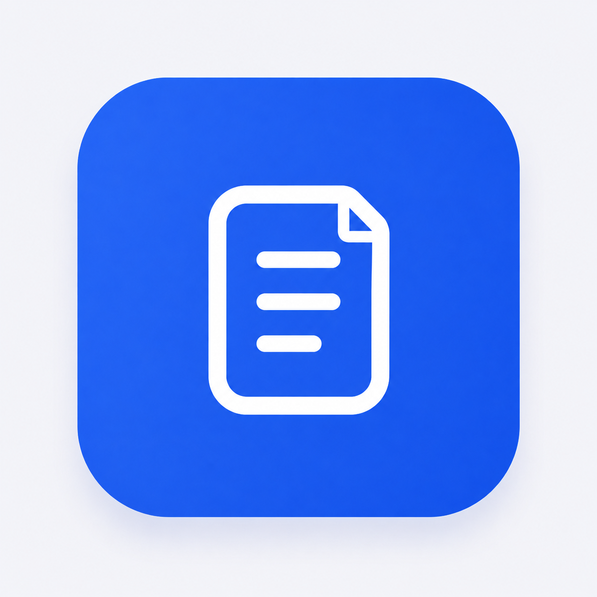
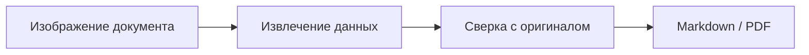
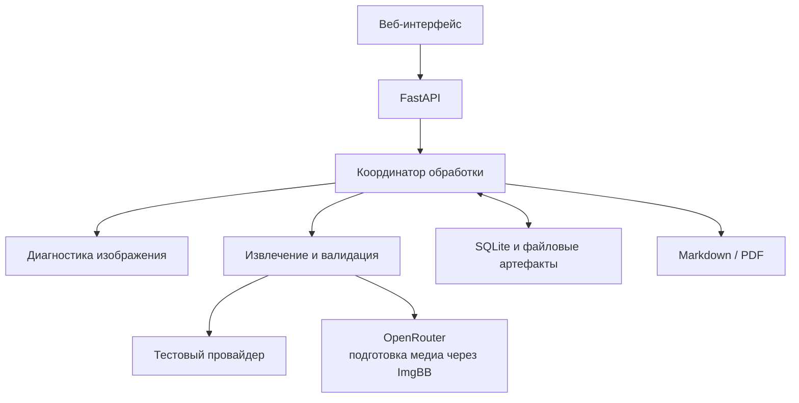

<p align="center">
  
</p>

<h1 align="center">DocuStruct AI</h1>

<p align="center">
  <strong>Изображение документа → поля, таблицы и текст</strong><br>
  Извлечение данных с помощью ИИ, сверка с оригиналом и экспорт в Markdown и PDF.
</p>

<div align="center">


[Демонстрация](#демонстрация) · [Возможности](#возможности) · [Устройство](#как-устроено) · [Запуск](#быстрый-старт) · [Документация](#документация)

</div>

## Зачем нужен

DocuStruct AI извлекает содержимое фотографий и сканов документов и собирает его в структурированный результат. Оригинал остаётся рядом: можно сверить распознанные значения, проверить таблицы и увидеть предупреждения о нечитаемых или неоднозначных фрагментах.

## Демонстрация

https://github.com/user-attachments/assets/b0e8d335-2986-4725-a828-bea599744766

### Скриншоты

<details>
<summary>Загрузка документа</summary>

<table>
<tr>
<td width="50%" valign="top"><b>Главная страница</b><br><a href="https://github.com/user-attachments/assets/2ec1e351-f191-4005-9a9a-f0ec317bfbdc"></a></td>
<td width="50%" valign="top"><b>Выбранный документ</b><br><a href="https://github.com/user-attachments/assets/9a57e61e-ca99-429d-9ec9-847d133cbb0f"></a></td>
</tr>
</table>

</details>

<details>
<summary>Проверка результата: сводка, значения, таблицы и предупреждения</summary>

<table>
<tr>
<td width="50%" valign="top"><b>Сводка и история</b><br><a href="https://github.com/user-attachments/assets/f8ac03bd-1273-4db4-b503-42efb0e5c7e5"></a></td>
<td width="50%" valign="top"><b>Извлечённые значения</b><br><a href="https://github.com/user-attachments/assets/4daee3fc-7dce-4832-92e5-4c0457c47587"></a></td>
</tr>
<tr>
<td width="50%" valign="top"><b>Таблицы</b><br><a href="https://github.com/user-attachments/assets/575d3d74-e0a5-4fa4-a321-589cd82707a5"></a></td>
<td width="50%" valign="top"><b>Предупреждения</b><br><a href="https://github.com/user-attachments/assets/1691baf7-b3b9-4918-bcc8-1183f6ded104"></a></td>
</tr>
</table>

</details>

<details>
<summary>Текст и Markdown</summary>

<table>
<tr>
<td width="50%" valign="top"><b>Извлечённый текст</b><br><a href="https://github.com/user-attachments/assets/854bd249-4c87-4f71-b4c4-bbe9ad4bfb69"></a></td>
<td width="50%" valign="top"><b>Markdown</b><br><a href="https://github.com/user-attachments/assets/bfe93e50-52f0-4b51-83ed-38c8ea103397"></a></td>
</tr>
</table>

</details>

<details>
<summary>Пример обработки: исходный бланк и файлы результата</summary>

Бланк с печатным и рукописным текстом: извлечённые данные сопровождаются предупреждениями о частично читаемых записях.

PDF и Markdown — результат отдельного запуска на этом бланке.

<p align="center">
  <a href="https://github.com/user-attachments/assets/8cd54c9b-47a7-4aa6-91be-31bb6f004864"></a>
</p>

| Файл | Назначение |
| --- | --- |
| [Скачать PDF](https://github.com/user-attachments/files/33989430/analysis_e460bae08936.pdf) | Готовый отчёт для просмотра и передачи |
| [Скачать Markdown](https://github.com/user-attachments/files/33990173/e460bae0893642e2bc09e0a3b8e4593c.md) | Текстовый результат с полями, таблицами и предупреждениями |

</details>

## Возможности

| Задача | Что реализовано |
| --- | --- |
| Обработать документ | Загрузка изображения, диагностика качества и извлечение данных |
| Проверить результат | Оригинал рядом со сводкой, полями, таблицами, текстом и предупреждениями |
| Сохранить результат | Копирование и скачивание Markdown, экспорт PDF |
| Вернуться к документу | История задач, повторное открытие результата и удаление |



## Как устроено

Серверная часть отвечает за обработку, проверку и хранение результата; веб-интерфейс предоставляет рабочую область для его просмотра.



Ответ модели проверяется по схеме до использования. Пользовательский экспорт строится из принятого результата; внутренние ответы провайдера и отладочные данные остаются в хранилище. [Подробности архитектуры](docs/PROJECT_CONTEXT.md#5-обзор-архитектуры).

## Быстрый старт

Нужны Python ≥3.14 и [uv](https://docs.astral.sh/uv/). Из корня проекта в PowerShell:

```powershell
uv sync
if (-not (Test-Path .env)) { Copy-Item .env.example .env }
.\start-web.cmd
```

Приложение откроется по адресу [http://127.0.0.1:8000/app/](http://127.0.0.1:8000/app/). Окно сервера содержит логи; остановка — `Ctrl+C` или закрытие окна.

Начальная конфигурация использует локальный тестовый провайдер `fake` без внешних вызовов. Для извлечения данных из документа нужно явно включить OpenRouter и ImgBB: [настройки провайдера](docs/LLM_MODEL_POLICY.md#3-конфигурация-и-секреты), [подготовка медиа](docs/LLM_MODEL_POLICY.md#4-граница-подготовки-медиафайлов).

<details>
<summary>Ручной запуск и команды проверки</summary>

```powershell
uv run --with uvicorn uvicorn document_digitization_ai.api.http.app:create_app --factory --host 127.0.0.1 --port 8000
```

`uvicorn` предоставляется через `uv --with`. Проверка сервера: [http://127.0.0.1:8000/health](http://127.0.0.1:8000/health).

```powershell
uv run pytest
uv run ruff check .
uv run pyright
git diff --check
```

Стандартные тесты используют тестовых провайдеров. Проверка с реальным провайдером запускается отдельно: [инструкция](docs/LLM_MODEL_POLICY.md#9-правила-ручной-проверки-с-реальным-провайдером).

</details>

## Ограничения

- Поддерживаемый вход — изображения. PDF доступен как формат экспорта; обработка PDF на входе не заявлена.
- Качество изображения и рукописного текста влияет на распознавание; результат требует сверки с оригиналом.
- Приложение рассчитано на локальную работу: учётные записи, разделение данных пользователей, пакетная обработка и редактирование результата не реализованы.
- Срок хранения по умолчанию — 7 дней. Функция очистки существует, автоматического запуска по расписанию нет.

## Статус

Локальный прототип с открытым исходным кодом. Базовый рабочий сценарий собран за несколько дней; дальнейшее развитие в самостоятельный сервис отложено.

## Документация

- [Контекст и архитектура](docs/PROJECT_CONTEXT.md) — обработка, хранение, экспорт и границы реализации.
- [Карта проекта](docs/PROJECT_MAP.md) — модули и точки входа.
- [Политика LLM](docs/LLM_MODEL_POLICY.md) — провайдеры, конфигурация, валидация и внешние вызовы.
- [Контрольный список разработки](docs/DEVELOPMENT_CHECKLIST.md) — проверки при последующих изменениях.
